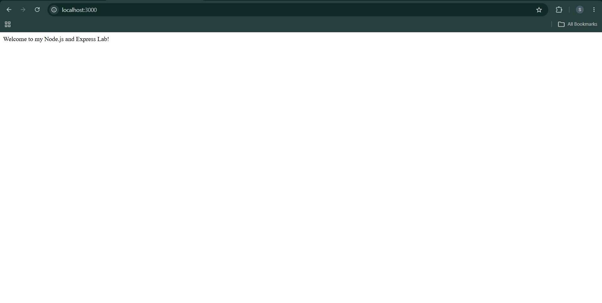
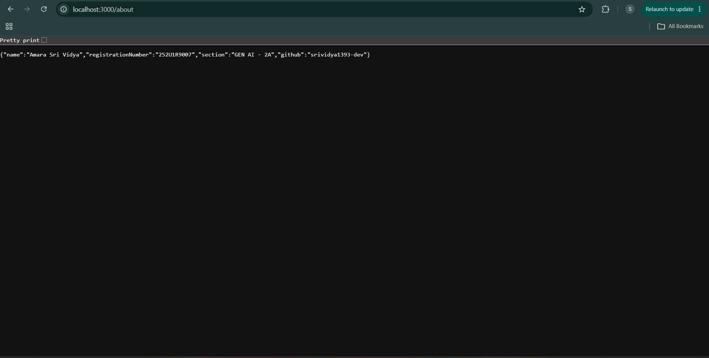
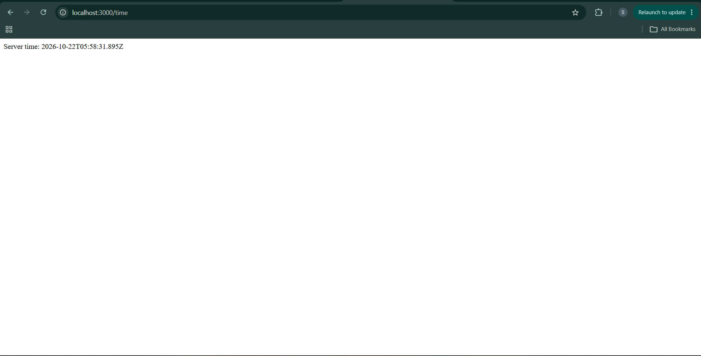
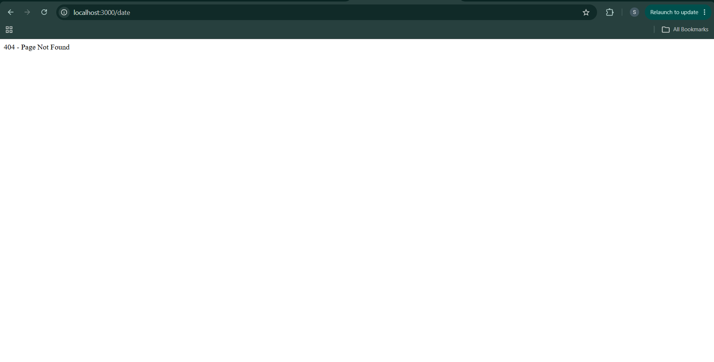

Lab 1: Node.js and Express Server
Name: Amara Sri Vidya
Registration Number: 252U1R9007
Section: Gen-AI 2A

 Live Link:
https://amara-node-express-lab1.vercel.app/
GitHub LInk: https://github.com/srividya1393-dev/Amara_Node_Express_Lab1

Project Description
A simple web server built using Node.js and Express.js. It provides welcome, about, and current-time routes, along with a 404 handler for unknown routes.

How to Run
1. Install Dependencies
npm install
2. Start the Server
node server.js
3. Open in Browser
http://localhost:3000

Endpoints
Method	Path	Description	Status Code
GET	/	Welcome message	200
GET	/about	Name and section in JSON	200
GET	/time	Current date and time	200
GET	/unknown	Not found response	404
SCREENSHOTS:
## Screenshots

### 1. Home Route

### 2. About Route

### 3. Time Route

### 4. 404 Response

Implemented the required routes using Express.js and tested their HTTP status codes.
- Node.js
- Express.js
- JavaScript
- Git and GitHub
